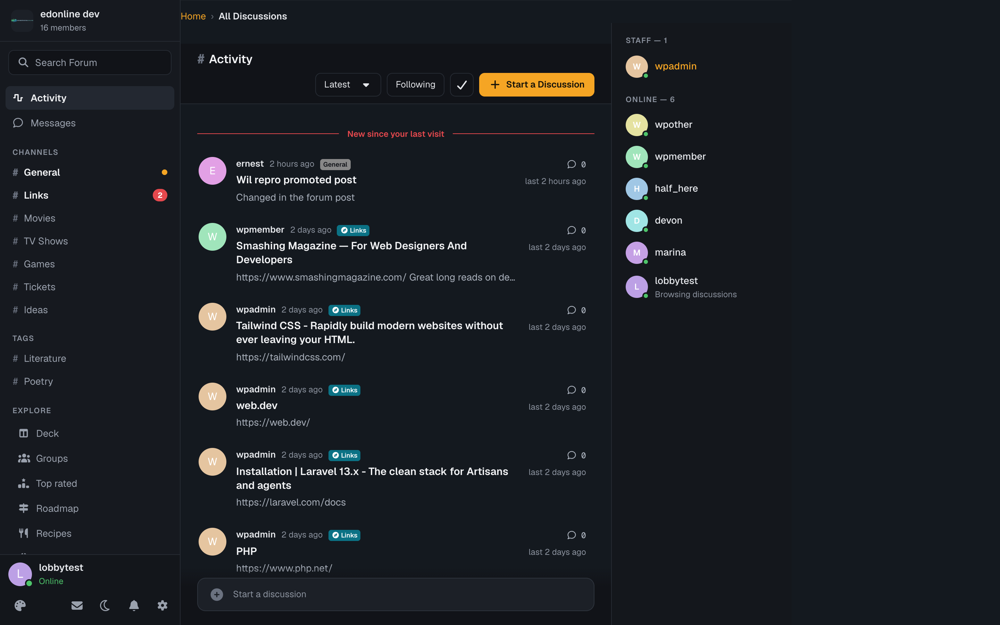
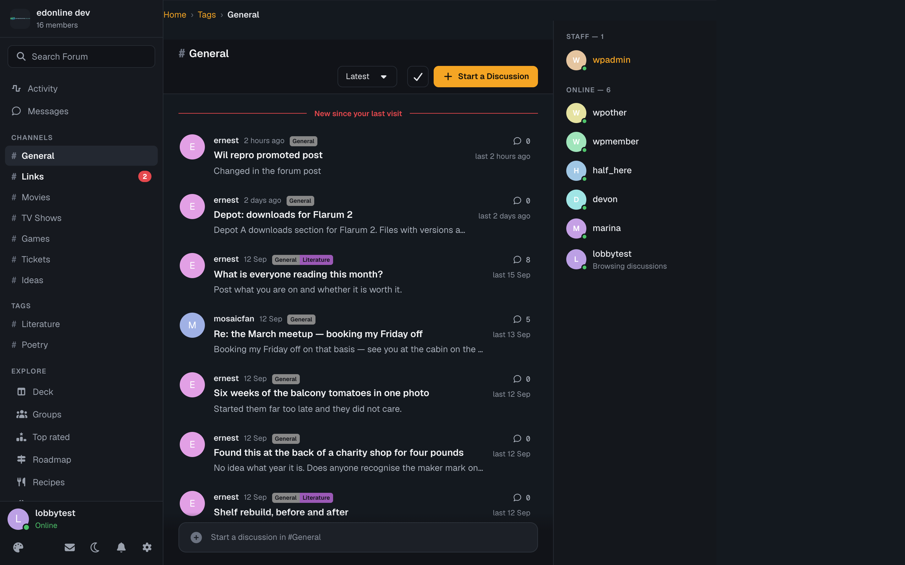
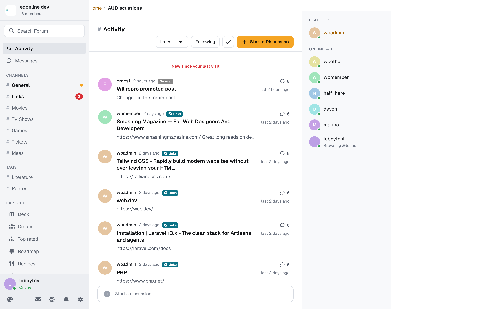
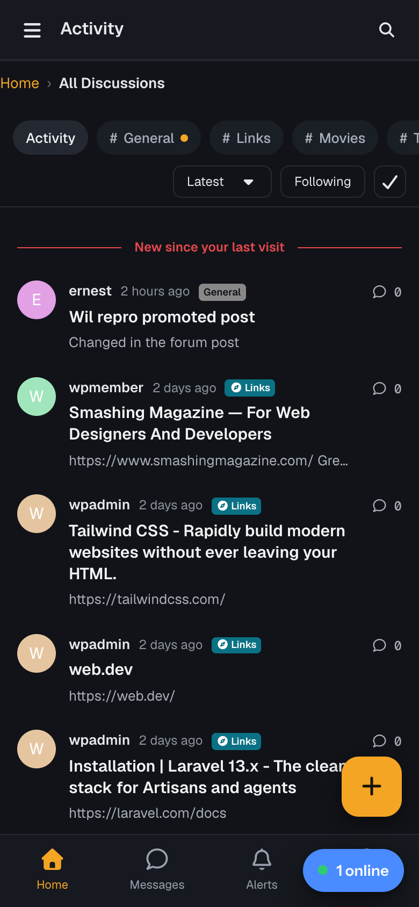
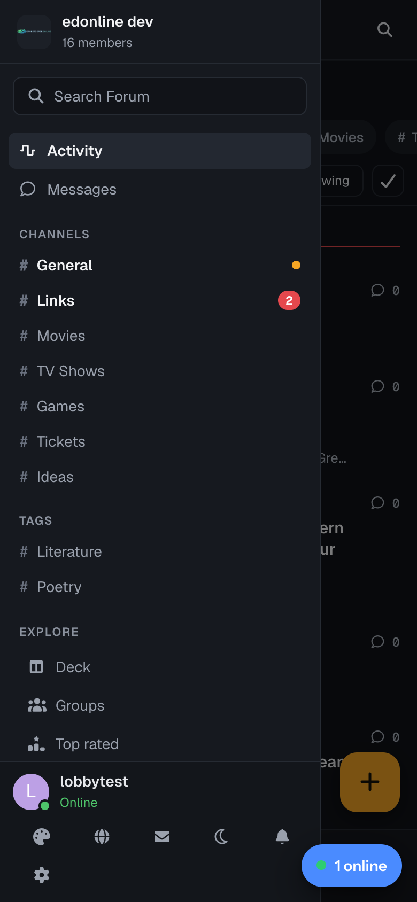

# Lobby

A dark-first community theme for **Flarum 2**, shaped like Discord and Circle. Tags become `#channels` in a left sidebar, discussions read as chat-style rows, and the people who are here right now are listed on the right.



## What it does

- **A sidebar on every page.** It holds the forum name and member count, search, Activity, and Messages with an unread badge (flarum/messages). Below those are your tags as `#channels`, then an Explore group with every link other extensions add. The bottom panel shows who you are, your online status, and the header's own controls: notifications, messages, theme switchers and the session menu.
- **Channels grouped the way your tags already are.** A primary tag with children becomes a group headed by its name. Primary tags without children share a *Channels* group. The most active secondary tags appear under *Tags*. The order is flarum/tags' own ordering.
- **Unread dots and mention badges.** A channel shows a dot when something was posted since your last visit (or since you last opened it). It shows a red count when it holds your unread mentions.
- **Each channel has a header** with its `#name` and description, the sort menu, Following, mark-all-read and **New discussion**.
- **Chat-style rows:** avatar, author, time, a **Pinned** chip (flarum/sticky), the title, a one-line excerpt, and on the right the reply count and last activity.
- **"New since your last visit"**: a divider above the first discussion that moved while you were away.
- **"Start a discussion in #channel"**: a bar at the foot of the list that opens the composer with the channel's tag already filled in.
- **An Online list.** Staff come first, then members, each with a presence dot. With ernestdefoe/presence installed, each person also shows what they are doing ("Browsing #General"). The list is also offered as a widget for **Bespoke** and **FoF Forum Widgets**.
- **Phones get their own layout:** a top bar, a row of channel chips, a floating compose button and a tab bar (Home, Messages, Alerts, You). The sidebar becomes a drawer.
- **A real light theme** for forums set to light or auto, not the dark one with the lights left on.

| Channel | Light |
|---|---|
|  |  |

| Phone | Channel drawer |
|---|---|
|  |  |

## Settings

*Admin → Lobby*

- **Accent colour**: Amber, Blue, Green, Pink, or the forum's own primary colour. The presets are tuned to read on both of Lobby's backgrounds.
- **Show the Online list**, and **how many people** it lists (5–100).
- **Staff groups**: whose members are listed first, under Staff.
- **Permission**: *See who is online* (guests by default).

## Privacy

- The Online list follows core's own **"Allow others to see when I am online"** preference. Members who turn it off are never listed. Staff who can see last-seen times see them marked *Invisible*, as core does.
- "Since your last visit" and channel read state are kept **in the reader's own browser**. Lobby stores nothing about visits on the server.
- **Geist and Geist Mono are self-hosted** (SIL OFL 1.1) and served with the forum's own assets, so no page makes a request to a font CDN.

## Cost

Measured with 25 tags (15 of them children) and 60 discussions. These numbers are enforced by the test suite.

| | Queries |
|---|---|
| Discussion list, 1 row or 50 | +1 for the whole page (the excerpt's first-post eager load); flat with the row count |
| Forum payload | +2 for a guest (child tags and their parents), +3 for a member (plus mentions, as one grouped query); flat with the number of channels |
| Online list | 1 for a guest when warm; who is online is one query cached for a minute and shared by every viewer |

| Every page | Size |
|---|---|
| forum.js | 21.0 KB minified, 6.5 KB gzipped |
| Lobby's CSS | 25.8 KB minified, 5.3 KB gzipped |
| Geist (latin) | 29 KB, preloaded; latin-ext and the mono face load only when a page uses them |

## Running it next to other themes

Lobby works with [Wardrobe](https://github.com/ernestdefoe/wardrobe). Declare it as a theme there and your members can choose it while everyone else keeps the forum's default.

## Install

```bash
composer require ernestdefoe/lobby
php flarum migrate
php flarum cache:clear
```

## Licence

Proprietary. The bundled Geist fonts are under the SIL Open Font License 1.1 (`assets/fonts/OFL.txt`).
